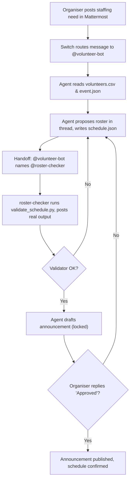

# Event Volunteer Desk

> A Switch room where an event organiser, student volunteers, and two AI agents plan and staff event shifts together — with a validator agent that checks every roster change before anything is announced.
> *Built for the **Flip the Switch Hackathon** (WeMakeDevs) — Business Workflow track.*

---

## The Problem

I'm a student volunteer in Lucknow, and event teams here coordinate volunteers over messy WhatsApp groups. Organising college hackathons and conferences (like the sample event in this repo, **HackAvadh 2026**) means chasing availability across dozens of chats and spreadsheets:

* Organisers waste hours collecting availability by hand, then build rosters in spreadsheets that are outdated the moment someone's exam schedule changes.
* Last-minute dropouts trigger manual scrambling, and the replacement picked is often someone who is already booked or not actually free.
* Volunteers don't know who to notify when they need to swap a shift.
* Announcements go out with missing coverage, because nothing checks the roster before it is published.

**Event Volunteer Desk** turns a team chat room into an operations desk: one agent proposes and edits the roster in conversation, a second agent independently validates every change by running a real Python script, and nothing is announced until the human organiser approves.

---

## How Switch Is Used

Switch is the core of this project — the whole workflow lives in one Switch room on **Mattermost**:

1. **Room:** the template creates the `volunteer-desk` room and mirrors it to Mattermost via Switch's **bridge**, with the deployer (`{$creator}`) in it.
2. **Two agents:** `volunteer-bot` (addresses `anyone` — organisers and volunteers talk to it) and `roster-checker` (addresses `owner-agents` — it answers agent handoffs).
3. **Handoff between agents:** after every change to `data/schedule.json`, `volunteer-bot` must address `@roster-checker` by name in the thread. roster-checker runs `python scripts/validate_schedule.py` and replies with the validator's exact output — it is instructed never to invent a result.
4. **Room instructions and rules:** `ROOM_RULES.md` ships inside the template itself — as the room's `instructions:` block and as a room document ("Room Rules") created with the room. Nothing needs to be pasted by hand. The rules enforce human sign-off before announcements, volunteer privacy, and `data/schedule.json` as the single source of truth.
5. **Human-in-the-loop gate:** `volunteer-bot` may only draft an announcement after roster-checker reports the schedule is OK **and** the organiser replies "Approved".



---

## Repository Structure
```text
event-volunteer-desk/
├── README.md                      # Project overview, architecture & reproduction steps
├── ROOM_RULES.md                  # Human-readable copy; the rules ship inside the template
├── volunteer-desk.template.yaml   # Switch template: two agents, room, rules, kickoff
├── data/                          # SAMPLE DATA — fictional volunteers and event
│   ├── event.json                 # Event metadata, shift windows & role quotas
│   ├── volunteers.csv             # 12 sample student volunteers with skills & availability
│   └── schedule.json              # Single source of truth for shift allocations
├── scripts/
│   ├── validate_schedule.py       # Checks capacity, double bookings, availability, skills, overlaps
│   ├── print_gaps.py              # Reports unfilled shifts + available, unbooked candidates
│   └── reset_demo.py              # Restores schedule.json to the clean demo state
├── tests/
│   └── test_validate.py           # pytest suite for the validator (13 tests)
└── demo/
    └── DEMO_SCRIPT.md             # Scene-by-scene recording script, validated per scene
```

---

## Step-by-Step Setup Guide

### 1. Prerequisites
* **Switch Console** ([Download a release](https://github.com/sandbox-quantum/switch/releases))
* **Docker Desktop** (for running the local Switch server + bundled Mattermost)
* **Python 3.10+** (for the validation helpers and tests)
* A coding-agent provider signed in (the template tries **Antigravity** first, then falls back to Claude Code, Codex, or OpenCode)

### 2. Launch the Local Switch Server
1. Start Docker Desktop.
2. Open **Switch Console** and start your local server (Switch Core + the bundled Mattermost on `http://localhost:8000`).
3. Under **Agent Providers**, sign in to the provider you want the agents to run on.

### 3. Create the Room from the Template
1. Clone this repository:
   ```bash
   git clone https://github.com/Mamtasahu2005/event-volunteer-desk
   ```
2. In **Switch Console**, open the **Templates** page and click **Import template**.
3. Choose the `volunteer-desk.template.yaml` file from this repository.
4. Click **Use** and fill the fields:
   * **Event name** — pre-filled with "HackAvadh 2026"; change it to your event.
   * **Repository URL** — pre-filled with this repo; the agents clone it into their working directory so both read and write the same `data/` and `scripts/`.
   * Advanced (folded): provider, machine/location, working directory, and the messaging app (bridge) — defaults pick the first installed provider, this machine, a shared folder under the agents directory, and the server's default app (Mattermost on the bundled server).
5. Click **Create**. Switch creates the `volunteer-desk` room in Mattermost, puts both agents and you in it, installs the room rules, and posts the kickoff (each agent says hello in one line).

### 4. Run the Checks
```bash
pip install pytest        # once, for the test suite
python scripts/reset_demo.py        # clean starting roster
python scripts/validate_schedule.py # validate the current schedule.json
python scripts/print_gaps.py        # unfilled shifts + eligible candidates
python -m pytest tests/ -v          # validator test suite
```

---

## Tested vs Untested

* **Tested:** the full flow was run on **Mattermost** via the bundled local Switch server; the validator, gap finder, and tests were run locally with the sample data.
* **Untested:** Switch's Slack and Discord bridges should work (the template takes any bridge the server has), but they have not been tried for this project.
* All names, emails, and availability rows in `data/` are **sample data** for the demo, not real volunteers.

---

## How to Run the Demo

Follow the scene-by-scene script in [`demo/DEMO_SCRIPT.md`](demo/DEMO_SCRIPT.md). In short:

1. **Staffing request:** the organiser asks @volunteer-bot to staff the Saturday morning shift.
2. **Proposal + handoff:** the agent proposes a roster respecting skills and availability, writes `data/schedule.json`, and hands off to @roster-checker, which posts the validator's real output.
3. **Swap:** a volunteer says he can only arrive at 11:00; the agent moves him to the afternoon shift and hands off to roster-checker again.
4. **Announcement gate:** the agent drafts the announcement (naming only confirmed volunteers, stating gaps openly) but does not publish.
5. **Sign-off:** the organiser replies "Approved"; the announcement is published and the schedule is marked confirmed, with one final validation.

---

## Screenshots & Demo Video Placeholders

| Interaction | Preview |
| :--- | :--- |
| **Switch Console & Agent Status** | *`[Placeholder: Screenshot of Switch Console showing both agents registered]`* |
| **Shift Proposal in Mattermost** | *`[Placeholder: Screenshot of threaded roster proposal in #volunteer-desk]`* |
| **Roster-Checker Validation** | *`[Placeholder: Screenshot of roster-checker posting the validator output]`* |
| **Approval Protocol Gate** | *`[Placeholder: Screenshot of agent waiting for organiser approval before posting]`* |

**Demo Video Link:** *`[Placeholder: Insert YouTube / Loom 2-minute demo link here]`*

---

## What I Learned

1. **Rooms beat solo prompts:** an agent embedded in a shared team channel, with the real data files in its working directory, can do operational work that a chat window alone cannot.
2. **A second agent as a checker helps:** making validation a separate agent that must paste real script output (and is forbidden from inventing results) keeps the coordinator agent honest.
3. **Human-in-the-loop safety matters:** requiring explicit organiser approval before any announcement prevented premature or wrong broadcasts during testing.
4. **Deterministic checks + conversation:** keeping `data/schedule.json` as machine-readable ground truth let both the agents and plain Python scripts agree on what is true.

---

## License

[MIT](LICENSE)
