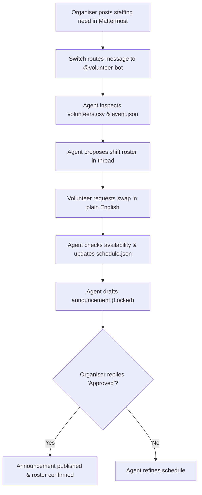

# 🎟️ Event Volunteer Desk

> **A collaborative Switch room where event organisers, student volunteers, and an AI agent plan and staff event shifts in real time.**  
> *Built for the **Flip the Switch Hackathon** (WeMakeDevs) — Business Track.*

---

## 💡 The Problem
Organising college hackathons and conferences (like **HackAvadh 2026** in Lucknow) involves coordinating dozens of student volunteers across dynamic shift schedules (Registration, Help Desk, Stage, Tech Support, Food Catering). 

Typically:
* Organisers waste hours chasing volunteer availability over messy WhatsApp groups and spreadsheets.
* Last-minute dropouts or exam conflicts trigger chaotic manual scrambling.
* Volunteers don't know who to notify when their shift needs swapping.
* Organisers accidentally publish unreviewed shift announcements with missing coverage.

**Event Volunteer Desk** solves this by turning a team chat room into an automated operations desk where humans and an AI agent work together with full context and human-in-the-loop safety.

---

## 🌟 How Switch is Used
Switch is the core communication and context backbone of this project:
1. **Chat as the Workspace:** The room brings the organiser, volunteers, and the `@volunteer-bot` agent into the same shared channel on **Mattermost** (or Slack/Discord).
2. **Shared Context & Single Source of Truth:** The agent reads `data/volunteers.csv` and `data/event.json`, and updates `data/schedule.json` live based on chat messages.
3. **Room Rules Enforcement:** The agent adheres to `ROOM_RULES.md`—it requires explicit human approval before announcements and protects volunteer privacy (no phone numbers leaked).
4. **Agent Protocol:** Antigravity operates as the agent provider, joining the room via Switch's native protocol.



---

## 📁 Repository Structure
```text
event-volunteer-desk/
├── README.md                      # Project overview, architecture & reproduction steps
├── ROOM_RULES.md                  # Operational safety guardrails enforced by agent
├── volunteer-desk.template.yaml   # Switch multi-agent room definition
├── data/
│   ├── event.json                 # Event metadata, shift windows & role quotas
│   ├── volunteers.csv             # 12 sample student volunteers with skills & availability
│   └── schedule.json              # Single source of truth for active shift allocations
├── scripts/
│   ├── validate_schedule.py       # Validates double-booking & capacity limits
│   └── print_gaps.py              # CLI tool reporting unfilled shifts & candidates
└── demo/
    └── DEMO_SCRIPT.md             # Exact line-by-line script for the demo video
```

---

## 🚀 Step-by-Step Setup Guide

### 1. Prerequisites
* **Switch Console** ([Download latest release](https://github.com/sandbox-quantum/switch/releases))
* **Docker Desktop** (for running Switch Core + bundled Mattermost)
* **Python 3.10+** (for running local schedule validation helpers)
* **Antigravity CLI** (or any supported agent provider)

### 2. Launch Local Switch Server
1. Start Docker Desktop on your machine.
2. Open **Switch Console** and start your local server (running switch-core and bundled Mattermost on `http://localhost:8000`).
3. Under **Agent Providers**, verify that **Antigravity** is signed in.

### 3. Create the Volunteer Desk Room
1. In Switch Console, import `volunteer-desk.template.yaml`:
   ```bash
   switch room create --template ./volunteer-desk.template.yaml
   ```
2. Switch will create the `#volunteer-desk` channel in Mattermost and invite `@volunteer-bot`.
3. Pin the contents of `ROOM_RULES.md` to the channel.

---

## 🎬 How to Run the Demo

Follow the exact interaction script in [`demo/DEMO_SCRIPT.md`](demo/DEMO_SCRIPT.md):

1. **Organiser Request:**  
   Post in the channel:
   > *"@volunteer-bot We have a huge rush expected at check-in on Saturday morning! We need 4 people at Registration & Check-in from 9:00 AM to 1:00 PM, and 2 people for Tech Support. Can you check availability and draft a roster?"*
2. **Agent Proposal:**  
   The agent reads `volunteers.csv`, matches skills and availability, and proposes a balanced shift plan in the thread.
3. **Volunteer Shift Swap:**  
   From a second account, type:
   > *"Hey @volunteer-bot, my college lab exam ends at 10:30 am on Saturday, so I won't reach campus until 11:00 am. Can I be swapped out of the 9 am morning slot, or moved to afternoon?"*
4. **Agent Reschedules:**  
   The agent reassigns the slot, updates `data/schedule.json`, and records the change in `change_log`.
5. **Human Approval:**  
   Organiser asks the agent to draft the announcement. The agent presents a draft with a **Safety Protocol Notice** requiring approval.
6. **Execution:**  
   Organiser types `"Approved"`, and the announcement is finalized.

---

## 🛠️ Verification Helpers
You can verify the state of the schedule at any point using the helper scripts:

* **Validate schedule consistency:**
  ```bash
  python scripts/validate_schedule.py
  ```
* **Print unfilled shift gaps and suggested candidates:**
  ```bash
  python scripts/print_gaps.py
  ```

---

## 📸 Screenshots & Demo Video Placeholders

| Interaction | Preview |
| :--- | :--- |
| **Switch Console & Agent Status** | *`[Placeholder: Screenshot of Switch Console showing volunteer-bot registered]`* |
| **Shift Proposal in Mattermost** | *`[Placeholder: Screenshot of threaded roster proposal in #volunteer-desk]`* |
| **Volunteer Swap & Reallocation** | *`[Placeholder: Screenshot of agent handling swap and updating schedule.json]`* |
| **Approval Protocol Gate** | *`[Placeholder: Screenshot of agent waiting for organiser approval before posting]`* |

🎥 **Demo Video Link:** *`[Placeholder: Insert YouTube / Loom 2-minute demo link here]`*

---

## 🧠 What I Learned
1. **Collaborative Rooms > Solo Prompts:** AI agents become exponentially more useful when embedded directly inside shared team channels rather than isolated IDE windows.
2. **Human-in-the-Loop Safety:** Autonomous agents must have strict boundaries—requiring approval before broadcasting notices prevented accidental or premature communications.
3. **Structured Shared State:** Keeping `data/schedule.json` as the machine-readable ground truth allowed both conversational AI interactions and deterministic validation scripts to work harmoniously.
